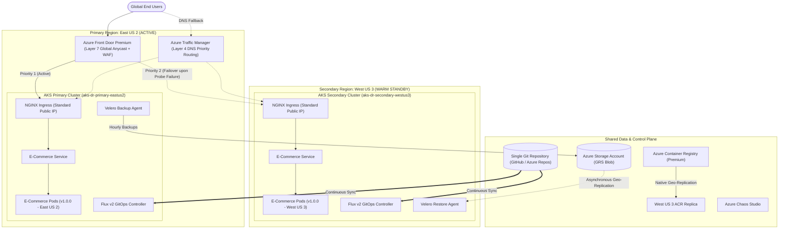
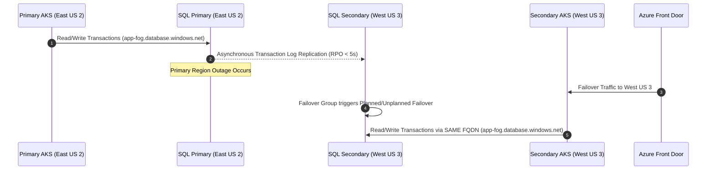
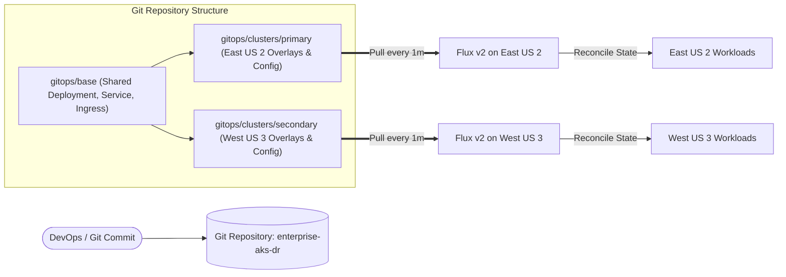

# Enterprise AKS Multi-Region Disaster Recovery Architecture

## 1. Architectural Overview

This enterprise architecture implements a **Multi-Region Active-Passive Disaster Recovery (DR)** model for a mission-critical e-commerce application on Azure Kubernetes Service (AKS).

- **Primary Region:** East US 2 (Active – handles 100% of production traffic under normal operations)
- **Secondary Region:** West US 3 (Passive / Warm Standby – ready to receive traffic within < 15 minutes)
- **Recovery Point Objective (RPO):** **<= 5 Minutes** (Maximum acceptable data loss)
- **Recovery Time Objective (RTO):** **<= 15 Minutes** (Maximum acceptable outage duration)

---

## 2. High-Level Architecture Diagram

---

## 3. Core Architectural Components & Technical Decisions

### 3.1 Primary Region: East US 2 (Active)
- **AKS Cluster:** Provisioned with Azure CNI networking, Azure RBAC, and Managed Identity.
- **Node Pool:** Single System Node Pool (`Standard_B2s` or `Standard_D2s_v5`) hosting both cluster system services and e-commerce application workloads.
- **Ingress Controller:** Ingress-NGINX with an Azure Standard Load Balancer Public IP.
- **GitOps:** Flux v2 actively reconciles the cluster state against the `gitops/clusters/primary` overlay.
- **Backup:** Velero runs scheduled hourly backups of Kubernetes manifests and persistent storage snapshots into Azure Blob Storage.

### 3.2 Secondary Region: West US 3 (Warm Standby vs Cold Standby)
> **Interview Question:** *"Why did you choose Warm Standby instead of Cold Standby in your DR design?"*  
> **Hinglish Answer:**  
> "Sir, business ka **RTO requirement 15 minutes** tha. Agar hum Cold Standby rakhte (matlab secondary cluster deploy hi na karte aur disaster aane pe Terraform se spin up karte), toh AKS cluster provision hone me hi **18 se 25 minutes** lag jaate hain (Control plane setup + node provisioning + CNI IP allocation). Isse RTO violate ho jata! Isliye humne **Warm Standby** architecture chuni: secondary cluster me 1 minimum viable node (`Standard_B2s`) hamesha up rehta hai, Flux v2 se manifests synced rehte hain, aur Front Door health probe fail hote hi < 2 minutes me traffic switch ho jata hai. Ye cost-efficient bhi hai aur 15-minute RTO ko easily satisfy karta hai."

### 3.3 Azure Front Door Premium vs Azure Traffic Manager
In an enterprise architecture, understanding the distinction between Layer 7 Reverse Proxy and Layer 4 DNS routing is fundamental:

| Dimension | Azure Front Door Premium | Azure Traffic Manager |
| :--- | :--- | :--- |
| **OSI Layer** | **Layer 7 (Application Layer)** | **Layer 4 (DNS / Transport Layer)** |
| **Routing Mechanism** | Global Anycast IP with split-TCP connections at edge PoPs. Reverse proxy terminates TLS at edge. | DNS Resolution: Returns the IP of the healthiest endpoint based on DNS queries. |
| **Failover Latency** | **Instant (10 to 30 seconds):** Detects origin failure via HTTP `/healthz` probe and immediately routes subsequent HTTP packets to Secondary origin. | **DNS TTL Dependent (60 to 300+ seconds):** Even if ATM detects failure, client machines and local ISP DNS resolvers cache the old IP until TTL expires. |
| **WAF & Security** | Built-in Web Application Firewall (OWASP Top 10, Bot protection, custom rate-limiting). | No WAF capabilities (pure DNS level). |
| **Role in this Project** | **Authoritative Primary Entry Point** for all end-user application traffic. | **Secondary / Fallback Demonstration** or for non-HTTP protocols. |

### 3.4 Azure Container Registry (ACR) Geo-Replication
- **Configuration:** ACR Premium SKU deployed in East US 2 with an automatic Geo-Replication replica in West US 3.
- **Benefit:** When an image is pushed to `myacr.azurecr.io`, Azure replicates the image layers across regions asynchronously behind the scenes.
- **Network Locality:** Both AKS clusters pull from the **same login server name** (`myacr.azurecr.io`). Azure DNS automatically resolves it to the closest regional replica, preventing cross-region egress charges and reducing pull latency during pod scaling.
- **Zero Credential Secrets:** Integrated natively via AKS Kubelet Managed Identity with `AcrPull` role assignment (no imagePullSecrets needed in YAML!).

---

## 4. Data Layer Disaster Recovery Strategy

### 4.1 Azure SQL Database: Active Geo-Replication & Auto-Failover Groups

- **Mechanism:** Azure SQL Auto-Failover Groups (FOG).
- **Connection Management:** Applications connect to a single Read/Write Listener FQDN (`<fog-name>.database.windows.net`). During failover, Azure SQL automatically updates DNS pointers; application connection strings do not require code changes or pod restarts!
- **RPO Performance:** Under normal asynchronous replication, replication lag is typically **< 5 seconds**, well within our 5-minute RPO threshold.

### 4.2 Azure Service Bus: Geo-Disaster Recovery (Geo-DR) Pairing
> **Crucial DevOps Caveat (Interview Must-Know):**  
> Azure Service Bus Geo-DR provides **Metadata Replication** (Queues, Topics, Subscriptions, Authorization Rules), but **does NOT replicate inflight messages** across regions!
- **How it works:** A Primary namespace is paired with a Secondary namespace using an **Alias Connection String**.
- **Failover:** If primary fails, invoking failover breaks the pairing and points the Alias to the secondary namespace.
- **Message Handling:** Messages already buffered in the primary namespace queues are NOT automatically migrated; they become accessible only when the primary region recovers (Failback phase).
- **Recommendation for Strict RPO:** For zero message loss, use active-active publisher patterns or client-side dual-write topologies.

---

## 5. GitOps Architecture (Flux v2)

- **Single Source of Truth:** All infrastructure and application configurations live in Git.
- **Drift Detection & Self-Healing:** If an operator manually runs `kubectl scale deployment --replicas=0` on the cluster, Flux v2 detects the drift on the next sync interval and automatically restores the replica count back to the Git-defined specification.
- **Kustomize Overlays:** Allows shared base manifests while cleanly injecting region-specific parameters (e.g. `REGION=East US 2` vs `REGION=West US 3`, replica counts, and DNS hosts).

---

## 6. Kubernetes Data Protection (Velero + GRS Storage)

- **Backup Target:** Azure Blob Storage with Geo-Redundant Storage (GRS).
- **What is Backed Up:**
  1. Kubernetes Resource Manifests (Deployments, Services, ConfigMaps, Secrets, Ingress, CRDs).
  2. Persistent Volume Claims (PVCs) using Azure Disk CSI Snapshots.
- **Cross-Region Restore Flow:**
  1. Velero in East US 2 takes backup: `velero backup create ecommerce-hourly --include-namespaces ecommerce`.
  2. Backup archive tarball and metadata are saved to Azure Storage Container in East US 2.
  3. Azure Storage GRS asynchronously replicates blobs to the paired region (West US 3).
  4. Secondary Velero in West US 3 points to the same storage container (or read-access secondary) and executes: `velero restore create --from-backup ecommerce-hourly`.

---

## 7. RPO & RTO Mathematical & Validation Methodology

### 7.1 Recovery Point Objective (RPO) Validation Formula
$$\text{RPO Window} = T_{\text{Disaster}} - T_{\text{Last Verified Backup/Replication}}$$
- **Target:** $\le 300\text{ seconds (5 minutes)}$.
- **Measurement:** Polled via Azure Monitor / Storage replication lag / Velero backup completion timestamps.

### 7.2 Recovery Time Objective (RTO) Validation Formula
$$\text{Actual RTO} = T_{\text{Secondary Healthy Response}} - T_{\text{Outage Injected}}$$
- **Target:** $\le 900\text{ seconds (15 minutes)}$.
- **Breakdown of RTO in Warm Standby:**
  - Outage Detection (Front Door Health Probes: 3 failed probes $\times$ 10s interval): **30 seconds**
  - Edge Route Convergence (Global Anycast route switch): **15 seconds**
  - Secondary Ingress & Pod Response Verification: **15 seconds**
  - **Estimated Realized RTO:** **~60 to 90 seconds** (significantly outperforming the 15-minute SLA!).

---

## 8. Bilingual Summary for L2/L3 Interview Discussion

| Technical Decision | English Explanation | Hinglish Explanation (Interview Ready) |
| :--- | :--- | :--- |
| **Why Active-Passive?** | Reduces licensing and database synchronization overhead while meeting the 15m RTO. | "Humne Active-Passive isliye choose kiya taaki secondary region ka cloud bill minimum rahe, par Warm Standby rakh ke 15-minute RTO easily beat kar sakein." |
| **Why Front Door instead of Traffic Manager?** | Front Door operates at Layer 7 with split-TCP and instant origin failover, bypassing client-side DNS caching delays. | "Front Door Layer 7 Anycast reverse proxy hai, toh jaise hi primary origin ka health probe fail hota hai, next HTTP request turant secondary origin pe bhej di jaati hai bina DNS cache expire hone ka wait kiye." |
| **Why Flux v2 GitOps?** | Eliminates manual drift and guarantees identical configuration state across both primary and secondary clusters. | "Disaster ke time manual `kubectl apply` karna human error laata hai. GitOps (Flux v2) se dono clusters single Git repo se sync rehte hain, toh secondary cluster hamesha ready aur updated milta hai." |
| **Why Velero with GRS?** | Provides cluster-agnostic migration and state restoration from cloud object storage. | "Velero Kubernetes resources aur persistent volumes ka backup Azure GRS Blob Storage me daalta hai, jisse secondary region me poora namespace as-it-is restore ho jata hai." |
