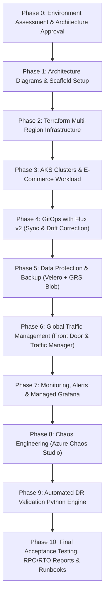

# Master Project Plan – Enterprise AKS Disaster Recovery POC

## 1. Overview & Project Objectives

- **Project Title:** Enterprise AKS Disaster Recovery: Multi-Region Failover, GitOps, and Chaos Engineering
- **Architecture:** Multi-Region Active-Passive (Primary: East US 2, Secondary: West US 3)
- **RPO Target:** 5 Minutes (Max allowable data loss window)
- **RTO Target:** 15 Minutes (Max allowable time to restore full service)
- **Implementation Methodology:** Phased, gated execution with explicit approval before infrastructure provisioning or destructive actions.

---

## 2. Phase-by-Phase Roadmap

---

## 3. Detailed Phase Breakdown

### Phase 0: Environment Assessment & Quota Validation (Current Phase)
- **Objectives:**
  - Inspect workstation tools (Azure CLI, Terraform, Kubectl, Helm, Git, Python, Flux, Velero).
  - Verify Azure identity, active subscription, regional quotas (vCPUs), and Resource Provider registrations.
  - Produce cost estimation and budget guardrails.
  - Deliver project plan and architectural strategy for user approval.
- **Deliverables:** `COST_ESTIMATION.md`, `PROJECT_PLAN.md`, `ARCHITECTURE.md`.
- **Checkpoint:** User review and approval to proceed to Phase 1/Phase 2.

### Phase 1: Architecture Design & Documentation
- **Objectives:**
  - Detailed architectural diagrams (Mermaid flowcharts & sequence diagrams).
  - Traffic routing comparison: Layer 7 (Azure Front Door) vs Layer 4 DNS (Azure Traffic Manager).
  - Data replication design for Azure SQL and Azure Service Bus.
  - RPO/RTO validation mathematical formulas and observability metrics.
- **Deliverables:** `ARCHITECTURE.md`, `docs/architecture.md`.

### Phase 2: Terraform Infrastructure Automation
- **Objectives:**
  - Build reusable modular Terraform code:
    - `modules/networking`: Virtual networks, subnets, NSGs for both regions.
    - `modules/aks`: Managed identity, Azure CNI, single-node system pools, autoscaling parameters.
    - `modules/acr`: Azure Container Registry with geo-replication configuration.
    - `modules/storage`: Geo-redundant storage (GRS) accounts for backups.
    - `modules/frontdoor`: Front Door profile, origin groups, health probes, routing rules, WAF.
    - `modules/traffic-manager`: DNS-level priority failover profile and endpoints.
    - `modules/monitoring`: Log Analytics workspace and Container Insights integration.
  - Format, initialize, and validate Terraform code:
    `terraform fmt -recursive && terraform init && terraform validate && terraform plan`
- **Checkpoint:** Review `terraform plan` output with estimated cost and wait for explicit approval before running `terraform apply`.

### Phase 3: AKS Cluster Deployment & Application Setup
- **Objectives:**
  - Provision Primary (`aks-dr-primary-eastus2`) and Secondary (`aks-dr-secondary-westus3`).
  - Deploy NGINX Ingress Controller on both clusters.
  - Build and containerize the sample E-Commerce web application (`homepage`, `/healthz`, `/readyz`, `/livez`, `/version`, and regional metadata tags).
  - Push image to ACR using cloud-native `az acr build`.
  - Deploy application to both clusters; verify region-specific tags (`East US 2` vs `West US 3`).
- **Validation:** `kubectl get nodes`, `kubectl get pods -A`, HTTP curl on ingress endpoints.

### Phase 4: GitOps Implementation with Flux v2
- **Objectives:**
  - Initialize Git repository structure (`gitops/base`, `gitops/clusters/primary`, `gitops/clusters/secondary`).
  - Install Flux v2 controllers in both clusters.
  - Configure `GitRepository` and `Kustomization` manifests.
  - Implement regional Kustomize overlays.
  - Demonstrate GitOps drift correction: manually modify a pod count or environment variable via `kubectl edit`, and observe Flux reconciling back to desired Git state.
- **Validation:** `flux check`, `flux get kustomizations`, drift test logs.

### Phase 5: Kubernetes Data Protection & Disaster Recovery (Velero)
- **Objectives:**
  - Configure Azure Blob Storage with GRS replication for backup archives.
  - Deploy Velero with Azure plugin to Primary and Secondary clusters.
  - Deploy persistent workload in `ecommerce` namespace with PVC.
  - Execute scheduled and on-demand backup on Primary cluster.
  - Validate cross-region replication of backup data in Azure Blob Storage.
  - Perform simulated disaster restore into the Secondary cluster.
- **Validation:** `velero backup get`, `velero restore create`, PVC and pod health in Secondary.

### Phase 6: Global Traffic Management & Automated Failover
- **Objectives:**
  - Wire Primary and Secondary Ingress Public IPs to Azure Front Door origin group.
  - Configure health probe path `/healthz` with 10-second probe interval and threshold.
  - Configure Priority Routing (Primary: Priority 1, Secondary: Priority 2).
  - Configure Azure Traffic Manager DNS-based priority failover.
  - Execute controlled failover: disable Primary origin or scale Primary ingress to 0.
  - Measure time taken for Front Door to re-route 100% of incoming requests to Secondary.
- **Validation:** Front Door probe logs, zero-downtime curl loop output.

### Phase 7: Observability, Alerts & Managed Grafana
- **Objectives:**
  - Configure Azure Monitor Metric and Log Analytics alerts:
    - AKS Node `NotReady` > 2 minutes.
    - Pod crash-loop condition > 3 restarts.
    - PVC storage utilization > 80%.
  - Configure Action Group for automated notification.
  - Create Azure Managed Grafana dashboard JSON (node availability, pod heatmaps, ingress traffic, health comparison).
- **Validation:** Alert fire simulation, Grafana dashboard query rendering.

### Phase 8: Chaos Engineering (Azure Chaos Studio)
- **Objectives:**
  - Register `Microsoft.Chaos` provider.
  - Target dedicated POC node and ingress pod.
  - Define Experiment 1: AKS Node Stop / Failure.
  - Define Experiment 2: Network Latency Injection (500 ms delay).
  - Define Experiment 3: Availability Zone / Pod Outage.
  - Document prerequisites, safety blast radius, rollback steps, and impact.
- **Checkpoint:** Explicit user authorization before starting any chaos experiment.

### Phase 9: Automated DR Validation Engine
- **Objectives:**
  - Build `scripts/dr_validation.py` using Python, Azure REST API, and kubectl.
  - Workflow:
    1. Read target Chaos Experiment or simulate outage.
    2. Poll Primary health endpoint and record failure detection timestamp ($T_{fail}$).
    3. Continuously poll Front Door / Traffic Manager DNS and HTTP endpoints.
    4. Detect Secondary failover switch ($T_{switch}$) and record secondary pod readiness ($T_{ready}$).
    5. Compute Actual RTO = $T_{ready} - T_{fail}$.
    6. Compute Actual RPO based on last replication/backup timestamp.
    7. Generate `reports/dr-report.json` and `reports/dr-summary.md`.
- **Validation:** Automated end-to-end execution script run with pass/fail exit code.

### Phase 10: Final Acceptance Testing, Documentation & Runbooks
- **Objectives:**
  - Execute all 14 Acceptance Criteria.
  - Author complete runbooks: `docs/failover-runbook.md`, `docs/failback-runbook.md`, `docs/troubleshooting.md`.
  - Prepare L2/L3 DevOps interview cheat sheet with bilingual explanations.
  - Generate final project handover summary.
