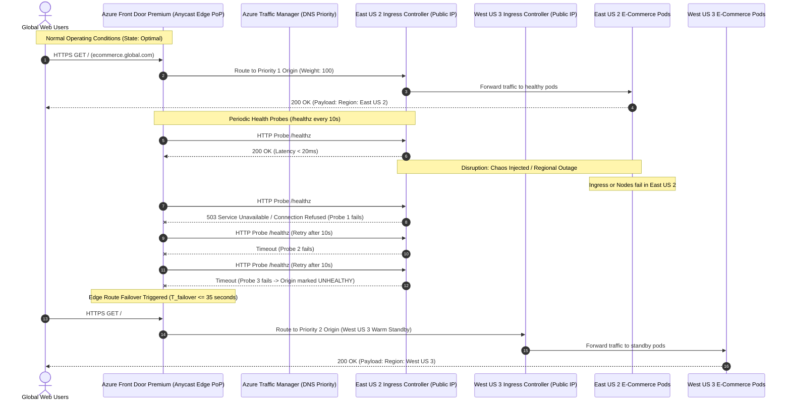
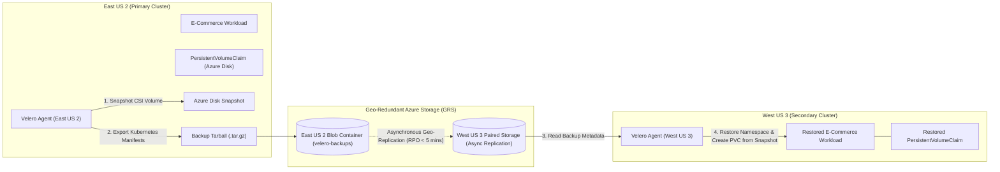
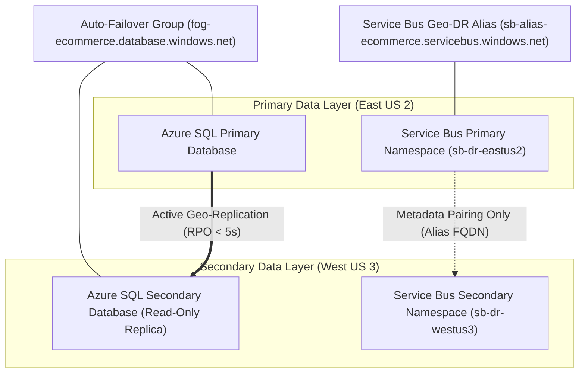
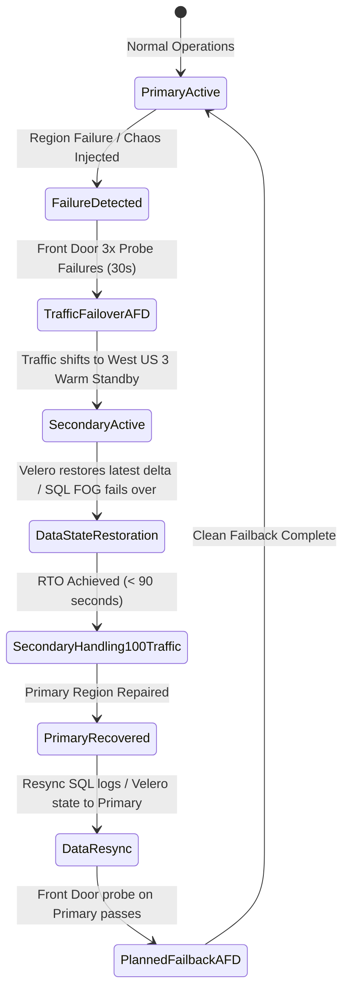

# Enterprise AKS Multi-Region Disaster Recovery: Comprehensive Architecture Specification

## 1. Architectural Scope and Mission

This document serves as the authoritative architectural blueprint for an enterprise-grade, Active-Passive Multi-Region Disaster Recovery (DR) solution on Azure Kubernetes Service (AKS).

- **Primary Region:** East US 2 (`eastus2`) — Active (100% production traffic)
- **Secondary Region:** West US 3 (`westus3`) — Warm Standby (Ready to serve within < 90 seconds)
- **Target RPO (Recovery Point Objective):** $\le 5\text{ minutes}$ (Maximum tolerable data loss)
- **Target RTO (Recovery Time Objective):** $\le 15\text{ minutes}$ (Maximum tolerable downtime)

---

## 2. Global Traffic Management & Failover Flow



### 2.1 Azure Front Door Premium vs Traffic Manager Dual-Layer Design
1. **Azure Front Door Premium (Layer 7 - Authoritative Application Gateway):**
   - **Split-TCP & SSL Offloading:** Terminates user SSL connections at the nearest Microsoft Edge Point of Presence (PoP) across 190+ locations globally, drastically reducing TCP handshake latency.
   - **Origin Group Configuration:**
     - Primary Origin: `eastus2-ingress.eastus2.cloudapp.azure.com` (Priority: 1, Weight: 100).
     - Secondary Origin: `westus3-ingress.westus3.cloudapp.azure.com` (Priority: 2, Weight: 100).
   - **Health Probe Settings:**
     - Path: `/healthz`
     - Protocol: HTTP (or HTTPS)
     - Probe Interval: `10 seconds`
     - Failure Threshold: `3 consecutive failed probes` (30 seconds detection time).
   - **WAF Integration:** Managed Web Application Firewall (OWASP 3.2 ruleset, Bot Manager, rate limiting).
2. **Azure Traffic Manager (Layer 4 - DNS Fallback):**
   - Configured with Priority routing.
   - Acts as an out-of-band DNS failover mechanism for non-HTTP endpoints or independent DNS verification.
   - **TTL:** Configured to `30 seconds` to minimize DNS caching delay.

---

## 3. AKS Cluster & Compute Topology

```mermaid
flowchart TB
    subgraph EastUS2 ["Primary Region: East US 2 (Active)"]
        subgraph VNetPri ["Virtual Network: 10.240.0.0/16"]
            SubnetPriAKS["AKS Subnet: 10.240.1.0/24"]
            SubnetPriIngress["Ingress Subnet: 10.240.2.0/24"]
            
            subgraph AKSPriCluster ["AKS Primary (aks-dr-primary-eastus2)"]
                NodePri["System Node (Standard_B2s, 2 vCPU, 4GB)"]
                
                subgraph K8sPriNamespaces ["Kubernetes Namespaces"]
                    KubeSystemPri["kube-system (CoreDNS, Konnectivity, Metrics)"]
                    IngressNginxPri["ingress-nginx (NGINX Ingress Controller)"]
                    FluxSystemPri["flux-system (GitOps Controllers)"]
                    VeleroPri["velero (Backup Agent & CSI Volume Snapshotter)"]
                    EcommercePri["ecommerce (Sample App v1.0.0, Region: East US 2)"]
                end
            end
        end
    end

    subgraph WestUS3 ["Secondary Region: West US 3 (Warm Standby)"]
        subgraph VNetSec ["Virtual Network: 10.241.0.0/16"]
            SubnetSecAKS["AKS Subnet: 10.241.1.0/24"]
            SubnetSecIngress["Ingress Subnet: 10.241.2.0/24"]
            
            subgraph AKSSecCluster ["AKS Secondary (aks-dr-secondary-westus3)"]
                NodeSec["System Node (Standard_B2s, 2 vCPU, 4GB)"]
                
                subgraph K8sSecNamespaces ["Kubernetes Namespaces"]
                    KubeSystemSec["kube-system (CoreDNS, Konnectivity, Metrics)"]
                    IngressNginxSec["ingress-nginx (NGINX Ingress Controller)"]
                    FluxSystemSec["flux-system (GitOps Controllers)"]
                    VeleroSec["velero (Restore Agent & CSI Volume Snapshotter)"]
                    EcommerceSec["ecommerce (Sample App v1.0.0, Region: West US 3)"]
                end
            end
        end
    end
```



### 3.1 Networking & Cluster Configuration
- **Network Model:** Azure CNI (`network_plugin = "azure"` or `azure-cni-overlay`).
- **Identity:** System-Assigned or User-Assigned Managed Identity.
- **Node Size:** `Standard_B2s` (2 vCPUs, 4 GiB memory) per cluster.
- **Quota Compliance:** Fits strictly within the 4 vCPU regional limit in both regions.
- **Load Balancer:** Standard SKU Azure Load Balancer with dynamic public IP allocation for Ingress-NGINX.

---

## 4. GitOps Workflow Architecture (Flux v2)

```mermaid
flowchart TD
    Git["Git Repository (GitHub / Azure Repos)"]
    
    subgraph GitRepoStructure ["Repository Layout"]
        Base["gitops/base/"]
        BaseYaml["- namespace.yaml\n- deployment.yaml\n- service.yaml\n- ingress.yaml\n- configmap.yaml"]
        Base --> BaseYaml
        
        OverPri["gitops/clusters/primary/"]
        OverPriYaml["- kustomization.yaml (Patches: REGION='East US 2', Replicas=2)"]
        OverPri --> OverPriYaml
        
        OverSec["gitops/clusters/secondary/"]
        OverSecYaml["- kustomization.yaml (Patches: REGION='West US 3', Replicas=1)"]
        OverSec --> OverSecYaml
    end

    Git -->|"GitRepository CR (poll interval: 1m)"| FluxSourcePri["Flux Source Controller (East US 2)"]
    Git -->|"GitRepository CR (poll interval: 1m)"| FluxSourceSec["Flux Source Controller (West US 3)"]

    FluxSourcePri --> FluxKustPri["Flux Kustomize Controller"]
    FluxSourceSec --> FluxKustSec["Flux Kustomize Controller"]

    FluxKustPri -->|"Apply Desired State"| K8sPri["AKS East US 2 Cluster"]
    FluxKustSec -->|"Apply Desired State"| K8sSec["AKS West US 3 Cluster"]

    K8sPri -.->|"Drift Detected!"| FluxKustPri
    Note over K8sPri,FluxKustPri: If an operator manually edits a manifest via kubectl,<br/>Flux detects drift and automatically reconciles back to Git.
```

---

## 5. Kubernetes Data Protection (Velero + GRS Storage)



### 5.1 Snapshot vs. Object Storage Replication (Interview Insight)
- **Manifests:** Stored as JSON/tar.gz files in Azure Blob Storage. Standard GRS storage replicates these blobs asynchronously to the paired region within minutes.
- **Persistent Volumes:** Velero uses the Azure CSI Snapshot plugin (`velero-plugin-for-microsoft-azure`). Volume snapshots are taken natively in the primary region's resource group. For cross-region volume recovery, snapshots must be copied to the target region or restored from geo-replicated backup repositories.

---

## 6. Data Layer Disaster Recovery (Azure SQL & Service Bus)



### 6.1 Azure SQL Auto-Failover Groups (FOG)
- **Automatic / Manual Failover:** Azure manages the DNS listener `fog-ecommerce.database.windows.net`. When failover occurs, the listener switches traffic to West US 3.
- **RPO:** Typically < 5 seconds due to asynchronous transaction log replication.
- **Zero Config Changes:** Application pods connect to the listener FQDN, eliminating the need to update connection strings during a DR event.

### 6.2 Service Bus Geo-DR Limitations
- **Metadata Replication Only:** Queues, Topics, and Subscription definitions are replicated.
- **In-flight Messages Are NOT Replicated:** If East US 2 goes down, any messages already sitting in the East US 2 queues remain there until East US 2 comes back online.
- **Mitigation:** Applications with zero-loss requirements implement sender-side deduplication or dual-write patterns.

---

## 7. End-to-End Disaster Failover & Failback Runbook Sequence


